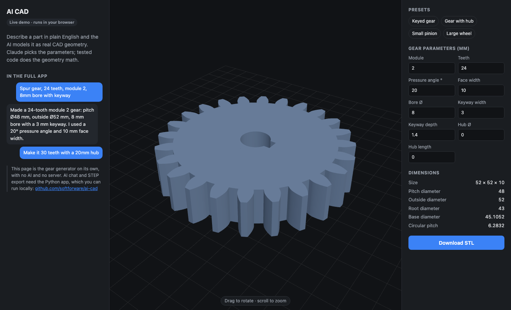

# AI CAD

Describe a mechanical part in plain English and get real CAD geometry back.

> "Spur gear, 24 teeth, module 2, 8mm bore with keyway"
> → a valid solid you can download as STEP or STL, then edit with "make it 30 teeth".

**Live demo:** https://softforware.github.io/ai-cad/ (the gear generator, running fully in your browser)



## How it works

The language model never does geometry math itself. Claude reads the request, picks parameters and calls tools; tested, deterministic code builds the geometry.

```
your request → Claude (tool use) → create_spur_gear(module=2, teeth=24, ...) → build123d / OpenCascade
                   ↑                                                                 │
                   └──────── validity + dimension checks, errors fed back ◄──────────┘
```

- **Spur gears** use a hand-written involute profile generator ([cad.py](cad.py)): addendum, dedendum, base circle, plus optional bore, keyway and hub.
- **Other parts** fall back to Claude writing [build123d](https://github.com/gumyr/build123d) code, which runs in a separate process with a timeout.
- Every result is checked (valid solid, bounding box, volume) and the numbers go back to Claude, so it can fix its own mistakes.
- Conversation history is kept per session, so follow-up edits work.

## Live demo vs. full app

| | Live demo | Full app (run locally) |
|---|---|---|
| Spur gear generator + 3D viewer | ✓ | ✓ |
| STL download | ✓ | ✓ |
| AI chat (Claude) | – | ✓ |
| Arbitrary parts via generated code | – | ✓ |
| STEP export | – | ✓ |

The demo ([docs/](docs/)) is a JavaScript port of the gear math in `cad.py`, checked to match the Python output to floating-point precision. It needs no server and no API key.

## Run the full app

Requires Python 3.10+ and an [Anthropic API key](https://console.anthropic.com/) created inside a workspace (it starts with `sk-ant-api03-`).

```sh
git clone https://github.com/softforware/ai-cad.git
cd ai-cad
python3 -m venv .venv
.venv/bin/pip install -r requirements.txt
echo 'ANTHROPIC_API_KEY=sk-ant-api03-...' > .env
./run.sh
```

Open http://127.0.0.1:8765. Without a key the parameter panel still works; only the chat is disabled.

## Project layout

| File | Purpose |
|---|---|
| [cad.py](cad.py) | Gear math, part generators, STEP/STL export, code sandbox |
| [agent.py](agent.py) | Claude tool definitions and the tool-use loop |
| [server.py](server.py) | FastAPI server: chat, direct gear endpoint, file downloads |
| [static/index.html](static/index.html) | Full app UI: chat, three.js viewer, parameter panel |
| [docs/](docs/) | Browser-only live demo (GitHub Pages) |

## Limitations

- Spur gears only have a dedicated generator; everything else relies on generated code.
- Gears with fewer than ~17 teeth are not undercut, so their profile is slightly idealized.
- The code sandbox is a subprocess with a timeout, not a security boundary. Don't expose the full app publicly as-is.
